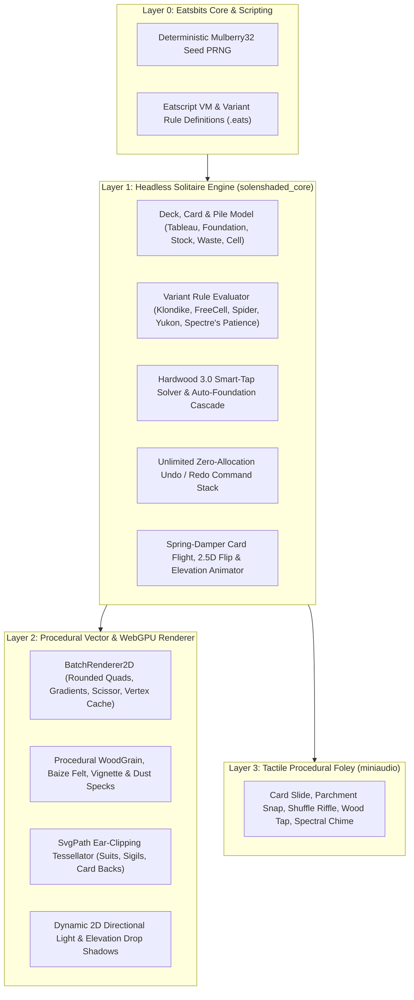

# Solitaire Enshaded (`SolEnshaded`) — Architectural & Lore Blueprint

> **Project Name:** Solitaire Enshaded (`SolEnshaded`)  
> **Repository:** `c:\git\solenshaded`  
> **Engine Foundation:** [Eatsbits](file:///c:/git/eatsbits/engine-blueprint.md) (C++20 / WebGPU / Eatscript / Procedural Audio)  
> **Shared Universe:** [Eatscharted](file:///c:/git/eatscharted/README.md) & Encharted (*The Enshaded Lands*)  
> **Design North Star:** *Hardwood Solitaire 3.0* (Desktop UI simplicity, tactile warmth, effortless ergonomics, zero mobile ad-bloat, 100% procedural rendering)

---

## 1. Vision & Philosophy: Why We Are Building SolEnshaded

**Hardwood Solitaire 3.0** (Desktop) remains the gold standard of solitaire software because it mastered three fundamentals that modern mobile card games destroyed:
1. **Uncluttered, Distraction-Free Beauty:** Warm, atmospheric wooden table surfaces, calm lighting, legible typography, and a quiet, recessed UI bar that never fights the cards for attention.
2. **Effortless Tactile Ergonomics:** Intelligent single-click/tap moves, buttery-smooth card flight arcs, physical drop-shadow elevation when cards lift off the stack, and subtle acoustic feedback.
3. **Respect for the Player:** Modern mobile solitaire ports bury the game beneath mandatory video ads, gem currencies, pop-up upsells, and bloated bitmap downloads.

**Solitaire Enshaded (`SolEnshaded`)** restores the pure **Hardwood Solitaire 3.0** experience across both **Desktop (Native WebGPU)** and **Mobile/Web (WebAssembly + WebGPU PWA)** while anchoring its aesthetic and atmosphere in the **Eatscharted** world through the lens of the **Shades**.

---

## 2. World Lore: The *Shades* of Eatscharted (ZAngband Spectre Lineage)

In the shared world of **Eatscharted**, a **Shade** is inspired by **ZAngband's *Spectre* class**:
* **What is a Shade?** An incorporeal, tether-bound remnant of an ancient scholar, cartographer, or monarch who crossed the Veil (`The Umbral Threshold`) without relinquishing their memory. Like ZAngband's Spectres, Shades pass silently through stone and timber (`Pass-Wall`), sense the lifeblood and fate-threads of the living from afar (`Telepathy / Nether Sight`), drain ambient warmth, and weave destiny inside quiet candlelight sanctums.
* **Why Solitaire?** Across the taverns, sunken sanctums, and candlelit archive towers of the *Shattered Isles* and *Silvervale*, travelers and Shades alike play **"The Veil's Patience"**—a divination and patience game played with **Veil-bound Playing Cards** on carved hardwood and obsidian tables.
* **Thematic Suits & Court Motifs (Toggleable Classic vs. Enshaded Suits):**
  * **Spades ($\spadesuit$) — *Iron & Grave-Blades* (Obsidian / Midnight Indigo):** The martial orders and spectral wardens of the Sunken Sanctum.
  * **Hearts ($\heartsuit$) — *Ichors & Soul-Vessels* (Crimson / Cinnabar):** The tethered vitality that binds a Shade to the mortal plane.
  * **Diamonds ($\diamondsuit$) — *Aether & Waystones* (Amber Gold / Sunscorched Ochre):** Cartographic ley-shards and compasses of the Perilous Shores.
  * **Clubs ($\clubsuit$) — *Wraithwood & Elder Boughs* (Shadow Moss / Verdigris):** The twisted ancestral groves of the Highland Kingdom.
* **Diegetic Environment Progression:** Starting with a classic, warm **Candlelit Tavern Oak** table (pure Hardwood 3.0 homage), players can switch table environments drawn from the Eatscharted world:
  1. **Tavern Heartwood (Classic Hardwood 3.0):** Warm walnut/rosewood border molding, deep forest-green baize felt, and an overhead amber oil-lamp spotlight sweep.
  2. **The Sunken Sanctum (Spectre's Vault):** Carved slate and obsidian flagstones, silver-inked foundation runes, and cool spectral cyan lantern light.
  3. **Cartographer's Cabin (Perilous Shores):** Weathered shipwright teak, antique vellum playmat with faint compass-rose watermarks, and brass corner fittings.

---

## 3. Why Eatsbits is the Ideal Technical Foundation

Rather than shipping tens of megabytes of static PNG sprite sheets, **SolEnshaded** uses Eatsbits' modular C++20 engine to synthesize every visual and acoustic element procedurally:

### Key Engine Capabilities Leveraged Directly:
1. **Procedural Surface Materials ([`BatchRenderer2D`](file:///c:/git/solenshaded/include/eatsbits/ui/batch_renderer_2d.hpp)):**
   * Built-in `VectorPatternType::WoodGrain`, `VintagePatina`, `DiagonalMesh`, and `DotGrid` render hardwood table molding and woven cloth surfaces with zero bitmap textures.
   * [`drawRectVignette`](file:///c:/git/solenshaded/include/eatsbits/ui/batch_renderer_2d.hpp#L243) and [`drawDustSpecks`](file:///c:/git/solenshaded/include/eatsbits/ui/batch_renderer_2d.hpp#L246) create the signature Hardwood 3.0 overhead lamp warmth and floating motes.
2. **Pre-Tessellated Vector Caching ([`SvgPath`](file:///c:/git/solenshaded/include/eatsbits/ui/svg_path.hpp) & [`drawCachedVertices`](file:///c:/git/solenshaded/include/eatsbits/ui/batch_renderer_2d.hpp#L255)):**
   * Suit pips, corner indices, spectral filigree, and card backs are tessellated once into `Vertex2D` caches and stamped at 120 FPS with sub-millisecond CPU cost.
   * Static table borders and empty pile wells are cached via [`beginChromeRecording()`](file:///c:/git/solenshaded/include/eatsbits/ui/batch_renderer_2d.hpp#L320).
3. **Contextual 2D Lighting & Card Elevation ([`drawRectDropShadow`](file:///c:/git/solenshaded/include/eatsbits/ui/batch_renderer_2d.hpp#L332)):**
   * Cards resting in a stack cast a tight $1.5\text{px}$ shadow; cards lifted by the player or flying across the board smoothly rise to elevation $14.0\text{px}$, casting a soft, offset shadow toward the table's light vector.
4. **Eatscript Variant Definitions (`decks/*.eats`):**
   * New solitaire variants and custom Shade rule twists can be authored declaratively in `.eats` scripts without recompiling C++.
5. **Procedural Acoustic Foley (`AudioFoleyEngine`):**
   * Synthesizes crisp parchment slides, card snaps, wooden foundation clicks, and ethereal Spectre harmonic chimes in real time via `miniaudio.h`.

---

## 4. Deconstructing the "Hardwood Solitaire 3.0" Experience

Matching Hardwood Solitaire 3.0 is **not** a brute-force content problem—it is an **interaction polish** problem. Our implementation prioritizes four pillars in strict order:

### Pillar 1: Effortless Input & "Smart-Tap" Ergonomics
* **Single-Tap / Right-Click Smart Move:** Clicking or tapping any playable card (or face-up sub-stack) evaluates candidate destinations in priority order:
  1. Safe Foundation promotion.
  2. Best legal Tableau column (preferring non-empty columns that extend an existing build over empty columns, unless moving a King).
  3. Empty FreeCell / Reserve slot (if applicable).
* **Sub-Stack Dragging with Magnetic Snap:** Dragging a buried face-up card lifts the entire attached sub-stack as a cohesive fan with a wide drop-target tolerance so players never lose a drag to pixel-hunting.
* **Safe Auto-Complete Cascade:** Once a deal is deterministically solved (all cards face-up and unobstructed), cards cascade into the foundations along staggered parabolic arcs.

### Pillar 2: Physical Card Motion & 2.5D Illusions
* **Critically Damped Spring Trajectories:** Every card transition (deal, smart-move, undo, foundation jump) follows a smooth spring-damper curve with a subtle flight arc and a $1.0\times \to 1.06\times$ airborne scale boost.
* **2.5D Card Turn-Over:** Flipping a face-down card animates horizontal width scale via $\cos(\theta)$ from $1.0 \to 0.0 \to 1.0$, swapping from the procedural card-back geometry to the card-face geometry exactly at $\theta = \frac{\pi}{2}$ with a slight vertical perspective pinch.
* **Enshaded "Phase" Visuals:** When using a Hint or Spectre ability (such as *Nether Sight* peeking at a buried card or *Pass-Wall* shifting a blocked card in Enshaded mode), the card briefly renders with translucent spectral cyan edge-glow.

### Pillar 3: Responsive Desktop & Mobile Layout
* **Dynamic Aspect Adaptation:** Seamlessly adapts between **Desktop Widescreen (16:9 / 16:10)** and **Mobile Portrait / Landscape** without tiny illegible cards or overflowing columns.
* **Adaptive Tableau Compression:** Long tableau cascades automatically tighten their vertical fan stride so the bottom-most card never clips off the viewport.

### Pillar 4: Minimalist Hardwood 3.0 HUD Chrome
* A slim, carved wooden top bar (`New Deal`, `Variant`, `Table Theme`, `Seed`, `Score / Moves / Time`) and a tactile bottom action bar (`Undo`, `Redo`, `Hint / Nether Sight`, `Auto-Finish`) that stay completely out of the playfield's way.

---

## 5. Phased Implementation Roadmap

| Phase | Milestone | Effort | Deliverable |
| :--- | :--- | :--- | :--- |
| **Phase 1** | **Scaffolding & Core Solitaire State Machine** | *Completed* | Repository setup (`c:\git\solenshaded`), deterministic deck/seed PRNG, card/pile state model, Klondike & FreeCell rules, Smart-Tap solver, unlimited Undo/Redo, spring animation state, and procedural card/table renderer. |
| **Phase 2** | **Hardwood 3.0 Polish & Variant Expansion** | *2–3 Days* | 2.5D card flip animation, multi-card drag fan physics, auto-complete victory cascade, Spider & Yukon Eatscript rules, and responsive mobile portrait layout. |
| **Phase 3** | **Enshaded Lore & Procedural Art Pass** | *3–4 Days* | Ornate SVG vector court cards (*Spectre King*, *Veil Queen*, *Wraith Knight*), procedural geometric card backs, and *Sunken Sanctum* / *Perilous Shores* table themes. |
| **Phase 4** | **WebAssembly Mobile PWA & Campaign Mode** | *2–3 Days* | Touch gesture polish, offline PWA manifest (`build-web.ps1`), persistent statistics, and seeded *Enshaded Chronicle* deals tied to Eatscharted world seeds. |
